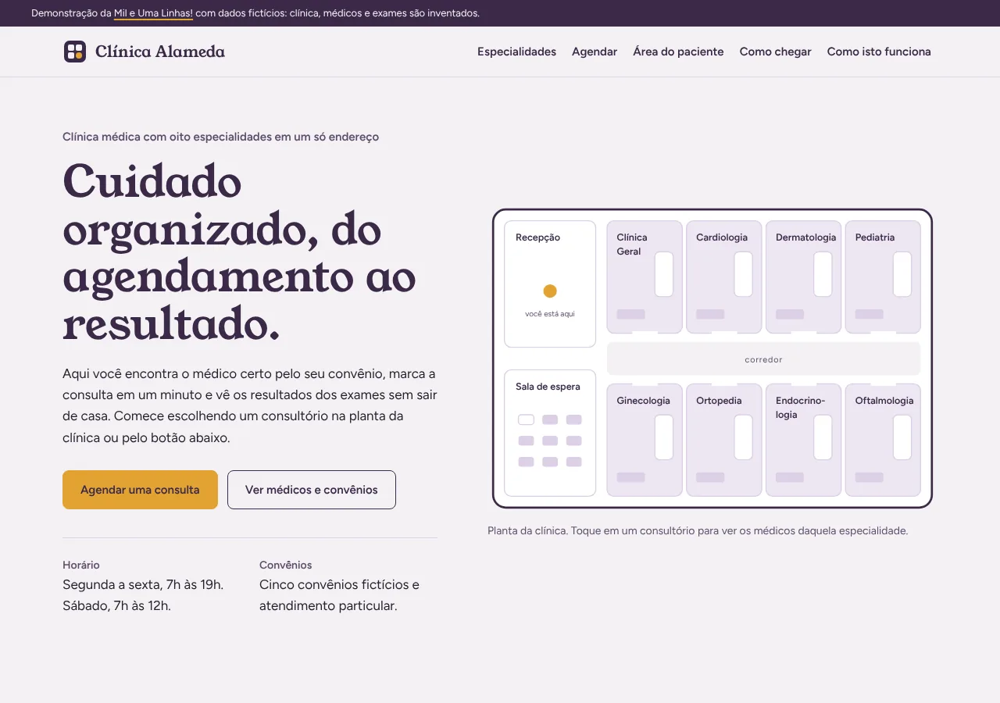
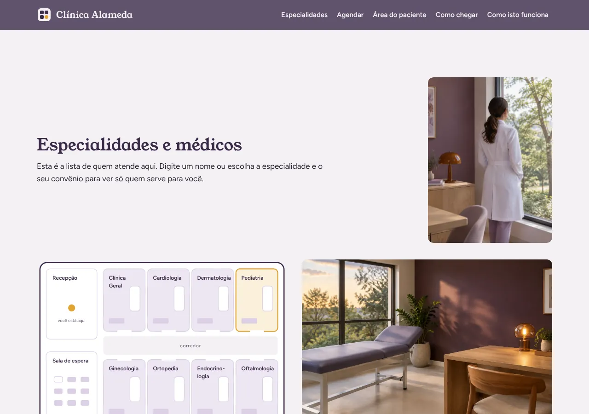
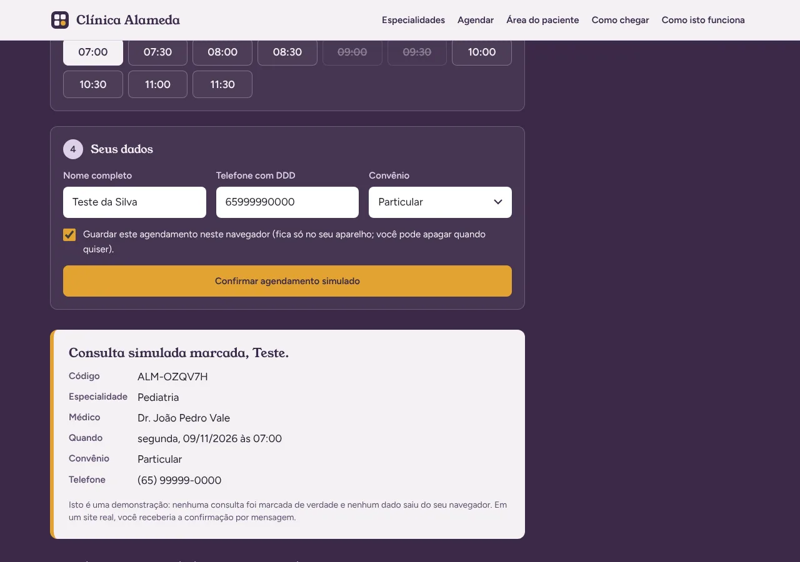
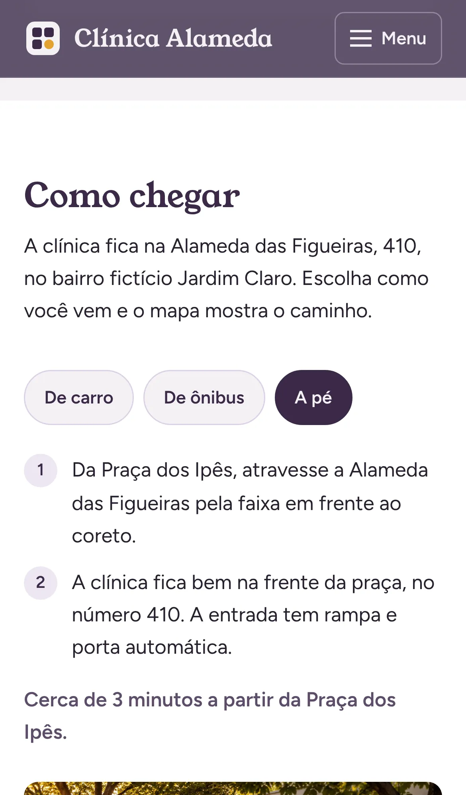
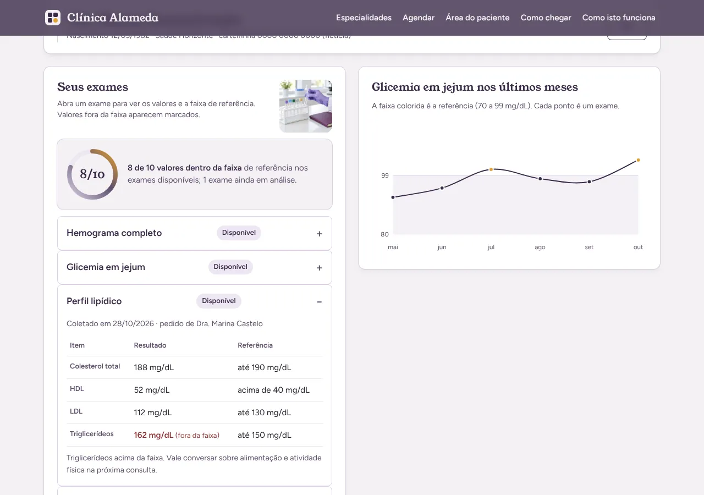
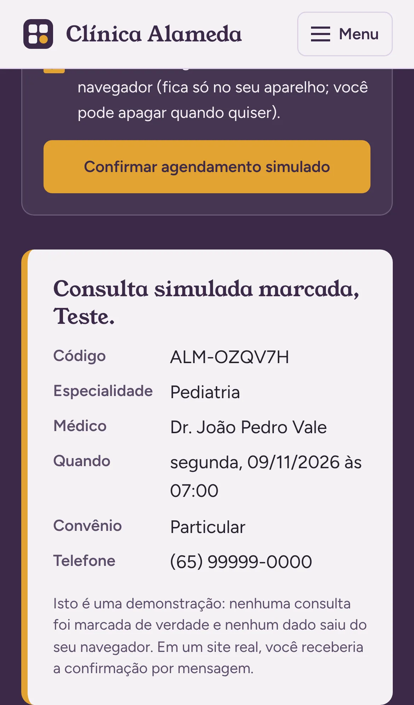
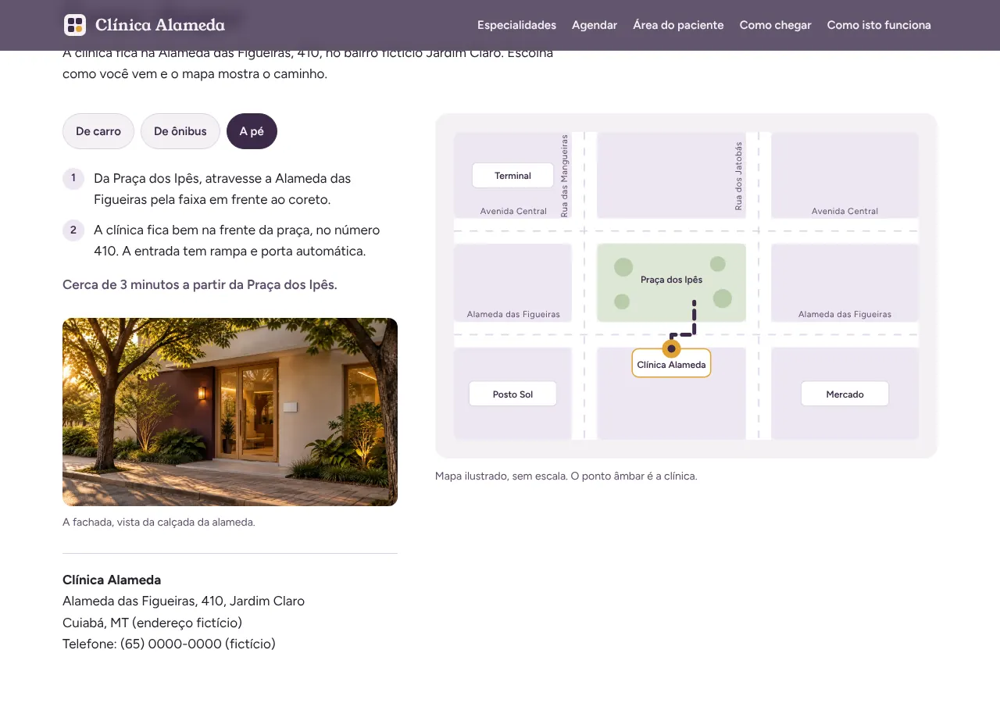

# Clínica Alameda: site de demonstração para clínicas médicas

Eu sou o Rodrigo Jr, da [Mil e Uma Linhas!](https://mileumalinhas.com.br), em Cuiabá. Este site é uma demonstração do que eu faço para clínicas médicas: um site bonito, com identidade própria, que não só mostra a clínica, mas funciona. Dá para buscar médico por convênio, marcar consulta, entrar na área do paciente e ver como chegar.

Site publicado: https://toshiro01001.github.io/clinica-medica/

**Aviso importante: tudo aqui é fictício.** A Clínica Alameda não existe. Os médicos, os convênios, a paciente, os exames, o endereço e o telefone foram inventados por mim para a demonstração. Nenhuma consulta é marcada de verdade e nenhum dado sai do seu navegador.



## O que o site faz (para quem não é da área)

Imagine o site de uma clínica de bairro. Você entra, vê a planta da clínica com cada consultório, toca em "Cardiologia" e aparecem os cardiologistas e os convênios que cada um aceita. Escolhe o médico, escolhe o dia no calendário, escolhe o horário e recebe a confirmação. Se já for paciente, entra na área do paciente e vê os resultados dos exames, com os valores fora da faixa marcados. E, se não souber o caminho, o mapa mostra como chegar de carro, de ônibus ou a pé.

Tudo isso acontece na hora, sem carregar outra página, no celular ou no computador.

## Como usar, passo a passo

1. Abra o site. No alto, toque em um consultório da planta (ou use o menu "Especialidades").
2. Na busca, escolha o seu convênio e, se quiser, digite o nome de um médico. A lista se ajusta sozinha.
3. Toque em "Agendar consulta". O site leva você para o agendamento com o médico já escolhido.
4. Escolha o dia no calendário (os dias em que o médico atende aparecem em branco) e depois um horário livre.
5. Preencha nome, telefone e convênio e toque em "Confirmar agendamento simulado". Aparece o resumo da consulta. Se marcar a caixinha, o agendamento fica guardado no seu navegador, e você pode apagar quando quiser.
6. Na "Área do paciente", entre com o usuário `paciente.demo` e a senha `demo1234` (estão escritos na própria tela). Abra um exame para ver os valores e veja o gráfico da glicemia.
7. Em "Como chegar", escolha "De carro", "De ônibus" ou "A pé" e veja a rota desenhada no mapa.

## Capturas

| Computador | Celular |
|---|---|
|  |  |
|  |  |
|  |  |
|  | |

## Identidade visual (resumo)

O estudo completo está em [`docs/identidade.md`](docs/identidade.md).

- **Nome e frase:** Clínica Alameda. "Cuidado organizado, do agendamento ao resultado."
- **Ideia central:** a planta da clínica. Cada consultório é uma especialidade e é clicável. A organização é a imagem.
- **Paleta:** Névoa `#F4F1F5` (fundo), Branco `#FFFFFF` (superfícies), Ameixa `#3B2A48` (identidade, títulos, cabeçalho), Tinta `#27212E` (texto), Lavanda `#DCD0E6` (apoio) e Âmbar `#E2A233` (destaque, um só lugar por tela). Fugi de propósito do verde-hospital e do azul-clínico: o lilás acinzentado é calmo e limpo, a ameixa é séria e acolhedora, o âmbar é a luz acesa da sala.
- **Fontes:** Young Serif nos títulos (serifa redonda, de placa de latão, sem negrito porque só tem um peso) e Figtree no texto e nos botões (humanista, ótima em tela pequena). As duas são locais, em `fonts/`, com licença SIL OFL.
- **Movimento:** só um momento orquestrado na abertura (as salas da planta acendem em sequência) e respostas às ações. Com "reduzir movimento" ligado no aparelho, nada se mexe.

## Como funciona por dentro (em linguagem comum)

Pense em uma agenda de papel muito bem organizada. A lista de médicos, os convênios, os exames da paciente de demonstração e as rotas do mapa estão escritos dentro do próprio site, no arquivo `js/dados.js`. Quando você filtra, agenda ou entra na área do paciente, o navegador do seu aparelho lê essa agenda, faz a conta e desenha a resposta na tela. Nada é enviado para a internet.

- **Busca:** a cada letra digitada ou filtro trocado, o site percorre a lista de médicos e mostra só quem combina com especialidade, convênio e texto.
- **Agendamento:** o calendário é gerado mês a mês a partir dos dias em que o médico atende. Os horários vêm do turno do médico, de 30 em 30 minutos, e alguns aparecem ocupados de forma fixa para a demonstração parecer real. A validação confere nome, telefone e convênio antes de mostrar o resumo.
- **Área do paciente:** o site compara o usuário e a senha digitados com os de demonstração. Se bater, mostra os exames e desenha o gráfico com os valores do arquivo de dados.
- **Mapa:** o mapa é um desenho em SVG. Cada rota é uma linha já desenhada que fica visível quando você escolhe o modo de transporte.

## Detalhes técnicos

- HTML, CSS e JavaScript puros. Sem framework, sem biblioteca, sem CDN, sem fonte externa, sem analytics.
- `Content-Security-Policy` por meta tag: `default-src 'self'`, sem script inline, sem atributo `style`, `connect-src 'none'`, `form-action 'none'`. Detalhes em [`docs/vistoria.md`](docs/vistoria.md).
- Acessibilidade: contraste AA verificado para todas as combinações da paleta, foco visível, navegação por teclado na planta, no calendário e nos horários, `aria-live` nos resultados da busca e nas rotas, SVGs com `title` e `desc`, tabela oculta com os valores do gráfico para leitores de tela, `lang="pt-BR"`.
- Celular primeiro: uma coluna a partir de 320px, duas a partir de 720px, grade completa a partir de 1024px.
- Fontes: `fonts/young-serif-latin-400-normal.woff2` e `fonts/figtree-latin-wght-normal.woff2` (variável, 300 a 900), extraídas dos pacotes `@fontsource/young-serif` e `@fontsource-variable/figtree`. Licenças na mesma pasta.
- Arquivos para publicação: `404.html` (com caminhos absolutos `/clinica-medica/`), `robots.txt`, `sitemap.xml`, `favicon.svg` e o arquivo de verificação do Google Search Console.

### Estrutura

```
index.html          página única com âncoras
404.html            página de erro
css/estilo.css      toda a folha de estilo
js/dados.js         dados fictícios (médicos, convênios, exames, rotas)
js/app.js           comportamento (busca, agenda, login, gráfico, mapa)
fonts/              woff2 locais e licenças
docs/               identidade, vistoria e capturas
tests/site.cjs      testes com Playwright
```

## Como rodar no seu computador

Qualquer servidor de arquivos estáticos serve. Com Python instalado:

```
python3 -m http.server 8304
```

Depois abra http://localhost:8304/ no navegador. Abrir o `index.html` direto do disco também funciona, mas as fontes podem não carregar por causa da política de segurança do navegador.

## Testes

Os testes usam Playwright e rodam em três tamanhos de tela: computador (1280x900), iPhone 13 e um celular estreito (320px). Em cada um, verificam erros de console, rolagem horizontal, elementos passando da borda, textos cortados e as quatro funções (busca, agendamento, área do paciente e mapa), além do menu do celular e da página 404.

```
npm i -D playwright        # uma vez, se ainda não tiver
python3 -m http.server 8304 &
node tests/site.cjs
```

Para salvar capturas durante o teste: `CAPTURAS=./capturas node tests/site.cjs`.

Resultado da última rodada (08/11/2026): tudo certo nas três telas, sem erro de console, sem rolagem horizontal, sem texto cortado.

## Segurança

Resumo da [vistoria](docs/vistoria.md): nenhum dado é enviado para lugar algum; o único armazenamento é a chave `clinica-alameda-agendamentos` no `localStorage`, e só se você marcar a caixinha; o acesso da área do paciente fica em memória e some ao recarregar; não há dependências em produção; não há senhas reais, chaves ou dados pessoais no repositório.

## Quer um site assim para a sua clínica?

Eu faço sites e sistemas sob medida, com identidade própria e funções de verdade. Fale comigo em https://mileumalinhas.com.br.
